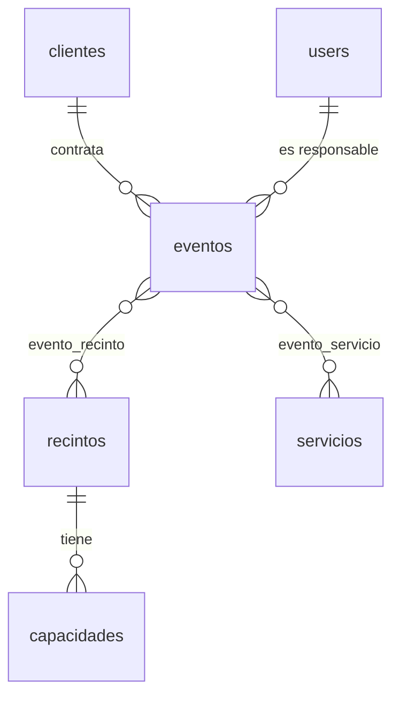

# EventPro — Espacios Magníficos S.A.

**Estudiante:** Sebastian (GitHub: Sebas05-06)
**Curso:** Programación web con Laravel (proyecto académico)

## Descripción

EventPro es el sitio web y panel de gestión de eventos del centro de convenciones "Espacios Magníficos S.A.". La parte pública muestra los servicios, los recintos con sus tarifas y capacidades (leídos de la base de datos) y un formulario para pedir cotización. La parte privada permite al personal iniciar sesión y administrar los eventos: cliente, recintos, servicios, fechas, asistentes y estado.

Funciones principales:

- Página principal con servicios y testimonios.
- Páginas independientes de recintos (`/recintos`) y de cotización (`/cotizacion`), que se abren en una pestaña nueva desde los botones y el menú.
- Formulario de cotización con validación en servidor; los mensajes se guardan en la base de datos.
- Registro e inicio de sesión con Laravel Breeze.
- Panel privado con CRUD de eventos.

## Tablas implementadas y relaciones

| Tabla | Descripción | Relaciones |
|---|---|---|
| `users` | Usuarios del sistema (personal interno) | 1 a N con `eventos` (responsable) |
| `clientes` | Clientes del centro de convenciones | 1 a N con `eventos` |
| `recintos` | Salas y auditorios con tarifa por hora y por día | 1 a N con `capacidades`; N a M con `eventos` |
| `capacidades` | Aforo de cada recinto según el montaje (teatro, escuela, banquete) | N a 1 con `recintos` |
| `servicios` | Servicios adicionales con precio y unidad | N a M con `eventos` |
| `eventos` | Eventos programados (tipo, fechas, asistentes, estado) | N a 1 con `clientes` y `users`; N a M con `recintos` y `servicios` |
| `evento_recinto` | Tabla pivote entre eventos y recintos (campo `montaje`) | N a M |
| `evento_servicio` | Tabla pivote entre eventos y servicios (campo `cantidad`) | N a M |
| `mensajes_contacto` | Solicitudes enviadas desde el formulario público | Sin relaciones |



## Instrucciones para correr localmente

Requisitos: PHP 8.4 o superior, Composer, Node.js y npm. La base de datos por defecto es SQLite, así que no hace falta instalar un servidor de base de datos.

```bash
composer install
npm install
cp .env.example .env
php artisan key:generate
touch database/database.sqlite
php artisan migrate --seed
npm run build
php artisan serve
```

En Windows (PowerShell) reemplaza `cp` por `copy` y `touch database/database.sqlite` por `New-Item database/database.sqlite`.

Abre `http://localhost:8000`. Para desarrollo con recarga automática de estilos, ejecuta `npm run dev` en una segunda terminal en lugar de `npm run build`.

El seeder crea un usuario administrador con las variables `ADMIN_EMAIL` y `ADMIN_PASSWORD`. Si no se definen, usa `admin@ejemplo.com` / `password` (solo para pruebas locales; defínelas antes de publicar el sitio).

## Capturas de pantalla

Página principal


Recintos y tarifas (`/recintos`)


Pedir cotización (`/cotizacion`)


Inicio de sesión


Listado de eventos


Formulario de evento


## Despliegue en Render

El proyecto se despliega en Render como Web Service con lenguaje **Docker** (ver `Dockerfile` y `docker-start.sh`). Deja vacío el campo de comando de inicio.

Variables de entorno que se cargan en Render (nunca se suben al repositorio):

| Variable | Valor |
|---|---|
| `APP_KEY` | Clave generada con `php artisan key:generate --show` |
| `APP_ENV` | `production` |
| `APP_DEBUG` | `false` |
| `APP_URL` | URL pública del sitio |
| `LOG_CHANNEL` | `stderr` |
| `ADMIN_EMAIL` | Correo del usuario administrador |
| `ADMIN_PASSWORD` | Contraseña del usuario administrador |

Por defecto la aplicación usa SQLite dentro del contenedor. En cada arranque se ejecutan las migraciones y el seeder, que carga los recintos, los servicios y el administrador. Los datos creados después se pierden cuando Render reinicia el servicio. Para conservarlos, define `DB_CONNECTION=mysql` junto con `DB_HOST`, `DB_PORT`, `DB_DATABASE`, `DB_USERNAME`, `DB_PASSWORD` y `MYSQL_ATTR_SSL_CA` (ruta relativa del certificado, por ejemplo `certs/aiven-ca.pem`) apuntando a una base MySQL externa.
